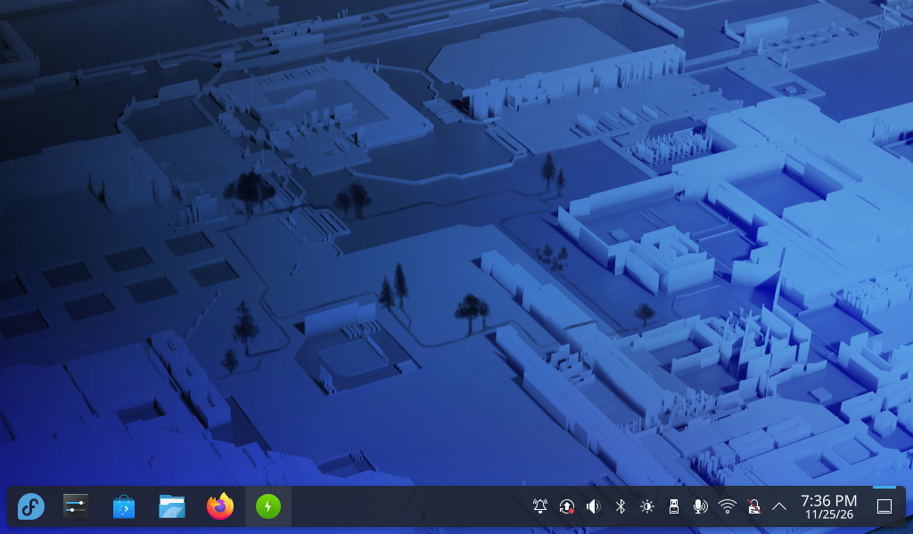
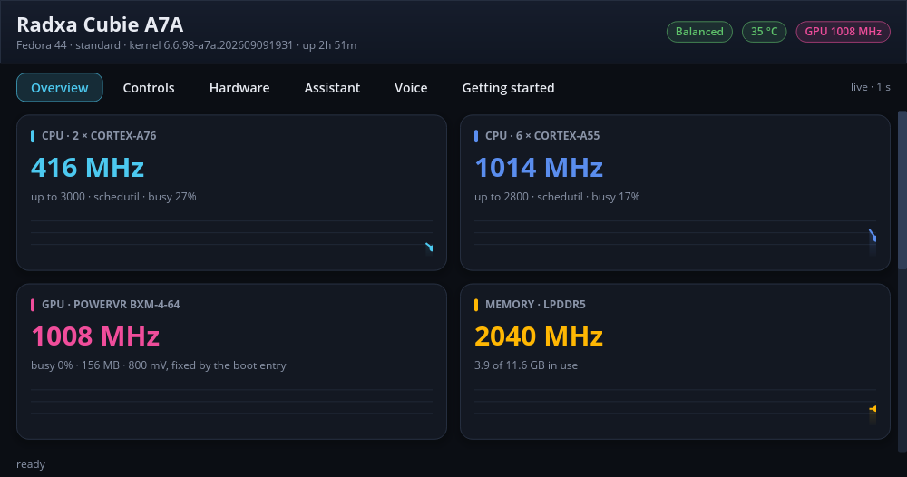
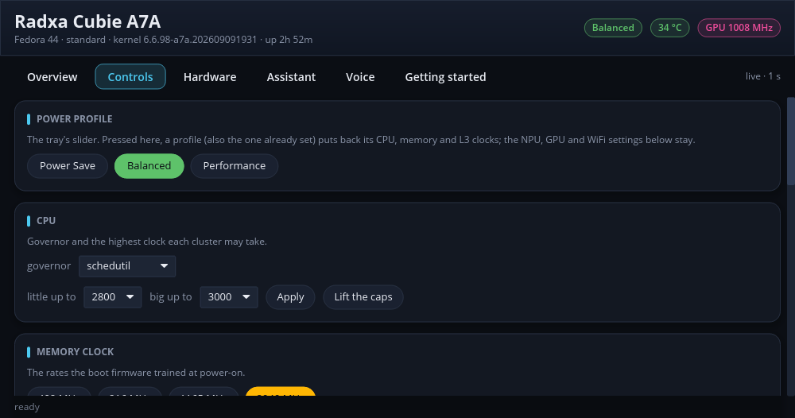
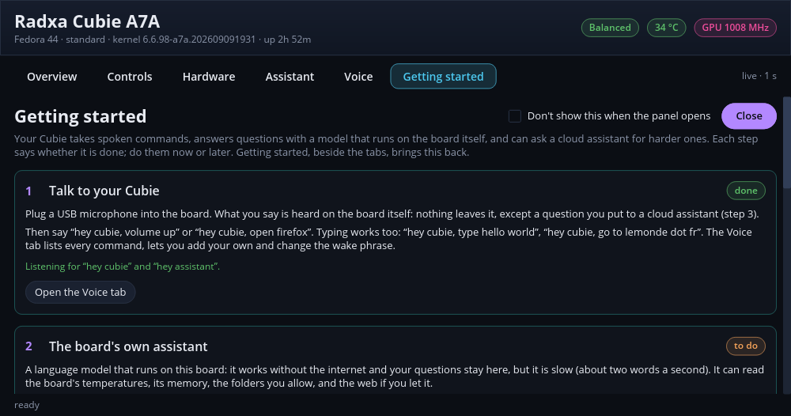
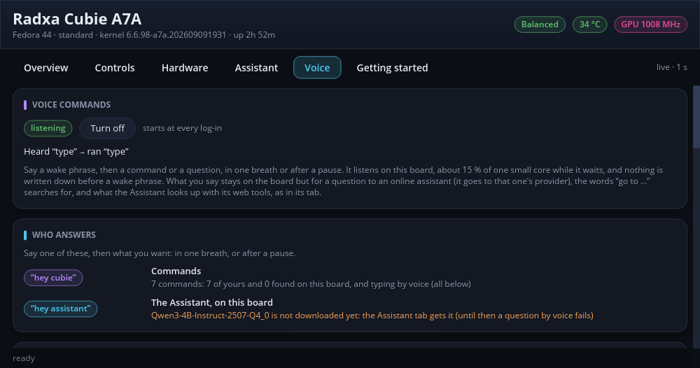
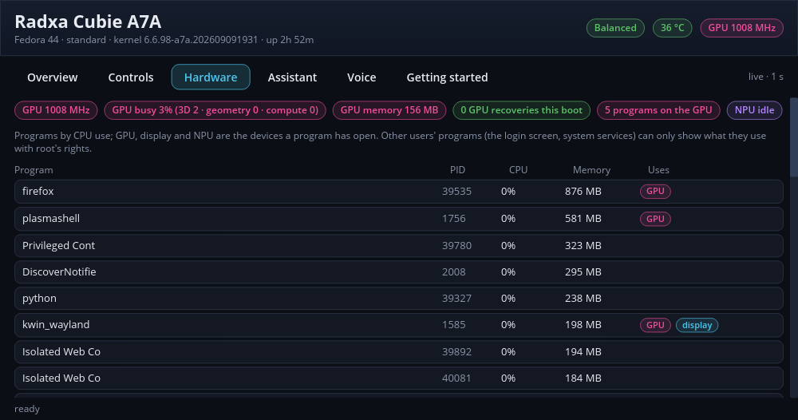
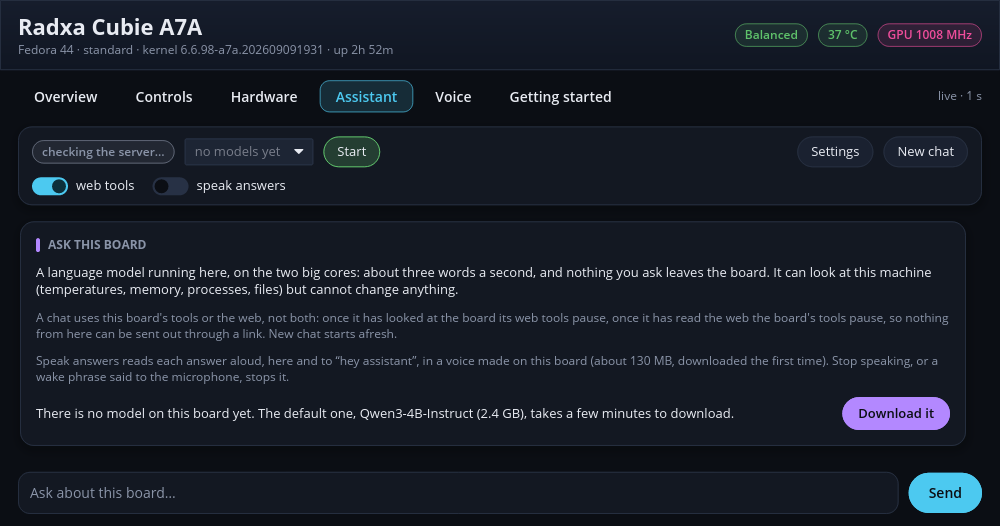

# Fedora 44 KDE for the Radxa Cubie A7A

A ready-to-flash Fedora 44 KDE Plasma image for the Radxa Cubie A7A (Allwinner A733), with the desktop drawn by the
board's PowerVR GPU, clock controls, a voice assistant that runs on the board, a language model that runs on the
board, optional cloud assistants, and an update channel for the board's own packages.

Built and tested by Rabs9 on one Cubie A7A. It is a hobby project, not a Radxa or Fedora product.

- [Screenshots](#screenshots)
- [Download and first start](#download-and-first-start)
- [What you get](#what-you-get)
- [GPU acceleration](#gpu-acceleration)
- [The A7A Panel](#the-a7a-panel)
- [Clocks and overclocking](#clocks-and-overclocking)
- [Voice commands and the NPU](#voice-commands-and-the-npu)
- [Spoken answers (text to speech)](#spoken-answers-text-to-speech)
- [The board's own language model](#the-boards-own-language-model)
- [Cloud assistants](#cloud-assistants)
- [Updates](#updates)
- [What was fixed to get here](#what-was-fixed-to-get-here)
- [Imagination's GPU driver: the one piece we need](#imaginations-gpu-driver-the-one-piece-we-need)
- [Known limits](#known-limits)
- [Licences](#licences)

## Screenshots

From the board, the standard image, 1024x600 screen:

| | |
|---|---|
|  |  |
| Overview: clocks, load and memory live | Controls: power profile, CPU caps, memory, L3, NPU, GPU, jack |
|  |  |
| Getting started: the setup guide | Voice: wake phrases and who answers them |
|  |  |
| Hardware: programs on the GPU, display and NPU | Assistant: the board's own model |

## Download and first start

Two images, the same system in each. They differ only in the memory clock set by the boot firmware:

| image | memory clock | for |
|---|---|---|
| `a7a-fedora-44-kde-<date>-standard.img.xz` | 2040 MHz | most boards: start here |
| `a7a-fedora-44-kde-<date>-oc.img.xz` | 2136 MHz | boards that are stable at 2040 and want the last bit |

Each is about 1.75 GB to download and 16 GB written out. Check the download against `SHA256SUMS`, then write it to
an SD card of 16 GB or more with balenaEtcher, Fedora Media Writer or `xzcat <image> | sudo dd of=/dev/sdX bs=4M
status=progress`.

On the first start the system grows to fill the card and makes its own machine identity, so it takes a little
longer. Then:

- **Log in as `radxa`, password `radxa`.** SSH is on with the same login: change the password with `passwd`.
- **Connect to Wi-Fi** from the network icon in the panel at the bottom (or plug in Ethernet).
- **Set your time zone.** The board starts on UTC: System Settings, search for "Date & Time".
- **Open the A7A Panel** (in the menu). Its "Getting started" guide walks through voice, the board's own assistant
  and a cloud assistant.

## What you get

- Fedora 44 KDE Plasma 6 on Wayland, composited on the PowerVR GPU through Imagination's driver.
- GPU acceleration for programs, with nothing to set up: Firefox (WebRender and WebGL 2.0), KDE and Qt programs,
  OpenGL ES games, and X11 programs through Xwayland.
- Two boot entries: the vendor GPU driver (the default, fast desktop and 3D) and the open upstream driver
  (`drm/imagination` with Mesa's PowerVR Vulkan driver), plus a recovery entry.
- The A7A Panel: clocks, temperatures, power profiles, the headphone jack, the assistant and voice settings.
- Voice commands ("hey cubie, open firefox"), typing by voice and dictation, all recognised on the board.
- A language model on the board that answers without the internet ("hey assistant, how hot is the board?").
- Spoken answers in ten voices, made on the board.
- Cloud assistants with your own free or paid key ("hey cloud, …").
- Board packages kept up to date through Discover or `dnf upgrade`, signed with the project's key.

## GPU acceleration

On the default boot entry, programs draw on the PowerVR GPU by themselves: no settings, no environment variables.
Measured on the board:

- **The desktop**: KWin and Plasma, and KDE and Qt programs (OpenGL ES 3.2).
- **Firefox**, unmodified, with its default profile: hardware WebRender, and WebGL 2.0 on the PowerVR.
- **OpenGL ES programs and games**, on Wayland and on X11 through Xwayland: glmark2-es2 scores about 2000;
  SuperTuxKart runs natively on Wayland at about 30 frames a second.

To see it: the A7A Panel's **Hardware** tab marks each program that uses the GPU, and `a7a-gpu-check` (in a
terminal) checks the whole stack and ends with "0 fail, 0 warn".

### Installing an app that needs the GPU

1. **Install it from Fedora's packages**: in Discover, pick the "Fedora" source when it offers both Fedora and
   Flathub; or in a terminal, `sudo dnf install <name>`. Fedora's builds use the system's graphics libraries, which
   on this image lead to the PowerVR driver.
2. **Start it as usual** and look at the Hardware tab: a **GPU** mark beside it means it draws on the PowerVR.
3. **If it needs desktop OpenGL**, it may not start on the default entry, or say "Failed to bind api" or something
   about GLX. Imagination's driver has OpenGL ES only (see
   [the GPU section](#imaginations-gpu-driver-the-one-piece-we-need)). Two ways:
   - on the default entry, in software: `LD_LIBRARY_PATH=/usr/lib64 <program>` (slower, but it runs);
   - on the GPU: start the board on the **second boot entry** (the open driver). There, desktop OpenGL runs on the
     PowerVR through zink (OpenGL on top of Mesa's PowerVR Vulkan driver), for Wayland and X11 programs alike.
4. **Vulkan programs** need the second boot entry too: Mesa's PowerVR Vulkan driver (Vulkan 1.2) shows windows on
   Wayland. On the default entry, Imagination's Vulkan driver cannot.
5. **Flatpak apps** (Flathub) bring their own graphics libraries, which do not include Imagination's driver: expect
   them to draw in software. For anything that needs the GPU, prefer Fedora's package. (Not measured here.)

### Switching between the two drivers

The boot menu shows only on a serial console, so the switch is a command, in a terminal:

- `sudo prepare616.sh`: the open driver (Mesa: desktop OpenGL through zink, Vulkan on Wayland) from the next start;
- `sudo backtoddk.sh`: back to Imagination's driver (the default: the fastest desktop and OpenGL ES).

Each makes its entry the default and restarts the board after 3 seconds; nothing is removed, and the session follows
the driver by itself.

## The A7A Panel

One window for the board:

- **Overview** and **Hardware**: CPU, GPU, memory and temperatures live, and which programs use the GPU and NPU.
- **Controls**: the power profile, CPU governor and caps, memory, NPU and L3 cache clocks, the GPU clock (as a boot
  entry, with a 5-minute stress test), the Wi-Fi band, and the headphone jack.
- **Assistant**: chat with the board's model or a cloud assistant, its settings, and spoken answers.
- **Voice**: set up and switch on voice commands, the wake phrases, your own commands, and the applications found on
  the board.
- **Getting started**: the setup guide; it opens with the panel until you tick "Don't show this when the panel opens".

**The headphone jack.** Radxa builds the A7A with one of two audio chips, the AC101 or the AC101B. The stock device
tree describes only the AC101B, so on an AC101 board the jack has no sound card. The panel notices this at start
("Switch to the AC101") and switches the board's device trees for you; after one restart the jack works, plays in
16-bit (24-bit came out 48 dB too quiet through this driver), and becomes the default output.

## Clocks and overclocking

These clocks run above the A733's stock settings. They were tested on the author's board; yours may differ. The
Power Save profile and the panel's controls let you go back down.

| part | in this image | notes |
|---|---|---|
| CPU, 2 big cores (Cortex-A76) | up to 3000 MHz | schedutil follows the load |
| CPU, 6 little cores (Cortex-A55) | up to 2800 MHz | |
| Memory | 2040 MHz (standard image), 2136 MHz (oc image) | set by the boot firmware at power-on; Radxa's own firmware runs 1800 MHz |
| L3 cache (DSU) | 780 MHz stock; 1352 MHz with the panel's module | "with the load" or fixed |
| GPU | 1008 MHz stock; 400 to 1300 MHz as boot entries | a clock is applied at the next start; run the stress test before keeping a high one |
| NPU | 492, 852 or 1008 MHz | |

KDE's power slider switches between three profiles: **Power Save** (little cores to 1196 MHz, big cores to 1508,
memory 854 MHz), **Balanced** (the default) and **Performance** (everything held at the top).

## Voice commands and the NPU

Say a wake phrase and a command in one breath:

- **"hey cubie, …"**: commands. Built in: volume up/down, mute, open the panel, lock the screen, how hot is it, and
  more. **Scan** in the Voice tab adds "open …" and "close …" for every application in the menu, and you can add your
  own phrase-and-command pairs.
- **Typing by voice**: "hey cubie, type hello world", "go to lemonde dot fr", "delete that", "start dictation" …
  "stop dictation", with "comma", "period", "new line" spoken where they go.
- **"hey assistant, …"**: a question for the board's language model.
- **"hey &lt;name&gt;, …"**: a question for a cloud assistant you named in the settings.

Everything is recognised on the board; nothing leaves it except a question you put to a cloud assistant. The speech
engine is sherpa-onnx with the GigaSpeech keyword spotter and Kroko's streaming English model. "Set up" in the Voice
tab downloads them once (about 450 MB with the engine).

The wake-phrase spotter can run on the A733's **NPU** instead of the CPU: `a7a-voice npu on` (and `off`); it falls
back to the CPU by itself if the NPU network does not load. `npu-run` runs other VIPLite networks on the NPU (a
ResNet-50 takes 7.55 ms at 1008 MHz, with the same top 5 as the vendor's reference).

## Spoken answers (text to speech)

Answers from the board's model and the cloud assistants can be read aloud: the "speak answers" switch in the
Assistant tab, with ten voices (five female, five male). The voice is Supertonic 3 (int8) running in sherpa-onnx on
the board, about 0.45 s of work for each second of speech. The first switch-on downloads it (about 130 MB). Saying
the wake phrase while an answer is being read stops it ("hey cubie, stop").

## The board's own language model

**Download the model** in the guide or the Assistant tab fetches Qwen3-4B-Instruct-2507 (Q4_0, 2.4 GB) and checks
its checksum; `a7a-llm` runs it with llama.cpp. It answers without the internet at about two words a second, with
an 8192-token context (16384 in the settings). It can read the board's temperatures and memory, the folders you
allow, and the web if you let it (search, a page, the weather); MCP servers can add more tools. Ask in the Assistant
tab, or "hey assistant, …": the answer comes as a notification, and aloud with speak answers on.

## Cloud assistants

For harder questions, the panel can ask a cloud model with your own key. The key stays in the panel's settings file
on the board (readable by your user only) and goes nowhere but that provider.

| provider | default model | notes |
|---|---|---|
| Cloudflare Workers AI | `@cf/openai/gpt-oss-120b` | free with an account, about 350 answers a day; tested on this board |
| Google Gemini | `gemini-flash-latest` | free tier with a Google account |
| Groq | (pick one) | free tier |
| OpenRouter | `openrouter/auto` | free models need prompt logging turned on |
| Mistral | `mistral-small-latest` | |
| Perplexity, OpenAI, any OpenAI-compatible server | | |

Each one you add gets a wake phrase from its name ("hey cloud", "hey google"). Brave's search key gives the board's
own model a web search.

## Updates

Fedora's own packages update as on any Fedora system, through Discover or `sudo dnf upgrade`.

The board's packages (the panel, the board tools, the GPU tools, the a7a Mesa builds, the boot menu tool) come from
this project's package repository, which the image already knows (`/etc/yum.repos.d/a7a-fedora.repo`, package
`a7a-repo`):

    https://rabs9.github.io/radxa-a7a-fedora44-packages/44/aarch64/

Every package there is signed with the project's key, which is in the image (`/etc/pki/rpm-gpg/RPM-GPG-KEY-a7a-fedora`,
fingerprint `3AB3 858C 3718 F479 3C34 0249 165C 525E 2634 1AA5`), and dnf refuses anything else. When the repository
cannot be reached, it is skipped and Fedora's updates go on. Kernels are not in it: a new kernel comes with a new
image. The image stays on Fedora 44: Discover may offer Fedora 45, which has not been tested on this board.

## What was fixed to get here

The parts that took the most work, on top of Radxa's kernel and Fedora:

- **The desktop on the GPU.** Radxa's Imagination driver ships for X11 only. A Wayland build of its Mesa layer with a
  lenient EGL config choice lets Plasma, KWin and Qt run on the PowerVR (a GL test window went from 283 to 2010
  frames a second), and keeps working with KWin 6.8. SuperTuxKart runs natively on Wayland at about 30 fps.
- **A display corruption storm.** The PowerVR's dma-buf export corrupted the display engine's IOMMU domain; two
  fixes in the `pvrsrvkm` kernel module (an fdinfo NULL guard and a mapping for importers).
- **GPU faults at 1200 MHz.** Traced and documented; the GPU stays at 1008 MHz unless you pick another clock.
- **The open GPU stack.** The upstream `drm/imagination` driver back-ported to this 6.6 kernel, with Mesa's PowerVR
  Vulkan driver patched for KWin (scratch-buffer reuse, a render-state cache, a load-op program cache).
- **Kernel fixes ported from Radxa's later tree**: swapped CPU thermal sensors, an IPv4 use-after-free, HDMI DDC retries.
- **Modules the kernel lacked**: exFAT, ISO 9660 and uinput.
- **A boot that could destroy itself.** systemd-repart, at first boot, formatted the space in front of the first
  partition and erased the boot firmware: masked.
- **Sleep.** The board cannot resume from suspend, which looked like a freeze: sleep is off.
- **The clock at power-on.** Without network time the board started at systemd's build date, and the daily clean-up
  then deleted the X11 socket folders: those are kept now, and the board starts at the time it last ran.
- **The headphone jack** (above), and the login screen's keyboard, logrotate and lm_sensors failing at boot.
- **First-run problems**: a full card, no internet, a cut download or a network's login page each say so in words,
  and a download carries on where it stopped.
- **Voice**: questions and commands said close together, wake-like words in the two seconds before the wake phrase,
  and wake phrases the spotter cannot hear (such as "hey qwen") are all handled.

The full engineering notes are in `docs/`; building the images yourself is described in
[docs/BUILDING.md](docs/BUILDING.md).

## Imagination's GPU driver: the one piece we need

The A7A's GPU is an Imagination PowerVR BXM-4-64. Two drivers run it in this image:

- **Imagination's own driver** (the default boot entry): the `pvrsrvkm` kernel module (source in Radxa's kernel), its
  firmware, and the closed user-space libraries Radxa ships in its Debian package (installed under `/opt/pvr`). It
  gives OpenGL ES 3.2 and Vulkan, and draws this desktop.
- **The open driver** (second boot entry): the upstream `drm/imagination` kernel driver and Mesa's PowerVR Vulkan
  driver. It runs, but is far slower for 3D (SuperTuxKart 4 fps against 30).

What only Imagination, or Radxa as their licensee, can provide, and what would finish this work:

1. **A desktop OpenGL module** (`libGL_PVR_MESA.so`). Fedora's Qt and many programs use desktop OpenGL; without it
   they run at an OpenGL ES 2.0 feature level, and desktop-GL-only programs do not start on the default entry.
2. **A Vulkan driver built for Wayland** (`libVK_IMG.so` with the Wayland window system). The one shipped can only
   present on X11.
3. **A fix for a Vulkan crash on X11** (`vkcube --wsi xcb` crashes in `wsi_common_get_images` with Radxa's own
   libraries).

These were asked for publicly in September 2026:
[radxa-pkg/allwinner-prebuilt-extra#24](https://github.com/radxa-pkg/allwinner-prebuilt-extra/issues/24).

## Known limits

- Tested on one board, the author's. The overclocks above are that board's.
- On the default entry, the lock screen's first start fails and KDE restarts it in software mode within a second; it
  locks and unlocks normally.
- Desktop-OpenGL-only programs need the open entry, or `LD_LIBRARY_PATH=/usr/lib64` on the default one (software).
- No suspend (the board cannot resume).
- New kernels come with new images, not through updates.
- The voice recogniser is English only.

## Licences

- This project's code: GPL-2.0 (`LICENSE`), except `tools/panel/vendor/iced_tiny_skia` (MIT, from iced).
- The A7A Panel's Rust libraries: MIT or Apache-2.0, each under its own licence.
- Fedora and KDE: their own licences, as shipped by Fedora.
- Speech: sherpa-onnx (Apache-2.0); Kroko's English model (CC-BY-SA, kroko.ai); Supertonic 3 (its licence is
  downloaded with the voice); the language model Qwen3-4B-Instruct-2507 (Apache-2.0, downloaded on request).
- Imagination's PowerVR firmware and libraries: Imagination's terms (see the GPU section).

Credits: the PowerVR GPU driver, its firmware and its libraries are © Imagination Technologies Ltd and are
included as Radxa ships them for the Cubie A7A; the firmware's licence is in `licenses/LICENSE.powervr`. The board, its
kernel tree and its board support are Radxa's (radxa.com); the A733 and its BSP are Allwinner's. Thanks to all three:
this image builds on their work. It is not endorsed by any of them, and anything here will be taken down on a
rights holder's request.
